<!-- README ini "dibangun live" oleh ratusan kursor AI. Dibuat dengan generate.py — edit di sana, bukan di sini. -->

✨ <a href="https://nauyand.github.io/nauyand/"><b>Buka versi interaktif</b></a>: tiap bagian dibangun ulang setiap kali kamu scroll ke sana

**Lihat proyek →** [SMARTMT-V3.0](https://github.com/nauyand/SMARTMT-V3.0) · [GPS-MQTT-VPS-MOBILEAPPS](https://github.com/nauyand/GPS-MQTT-VPS-MOBILEAPPS)

 

Animasi diputar saat halaman dibuka. Muat ulang halaman untuk menonton para kursor membangunnya lagi.

